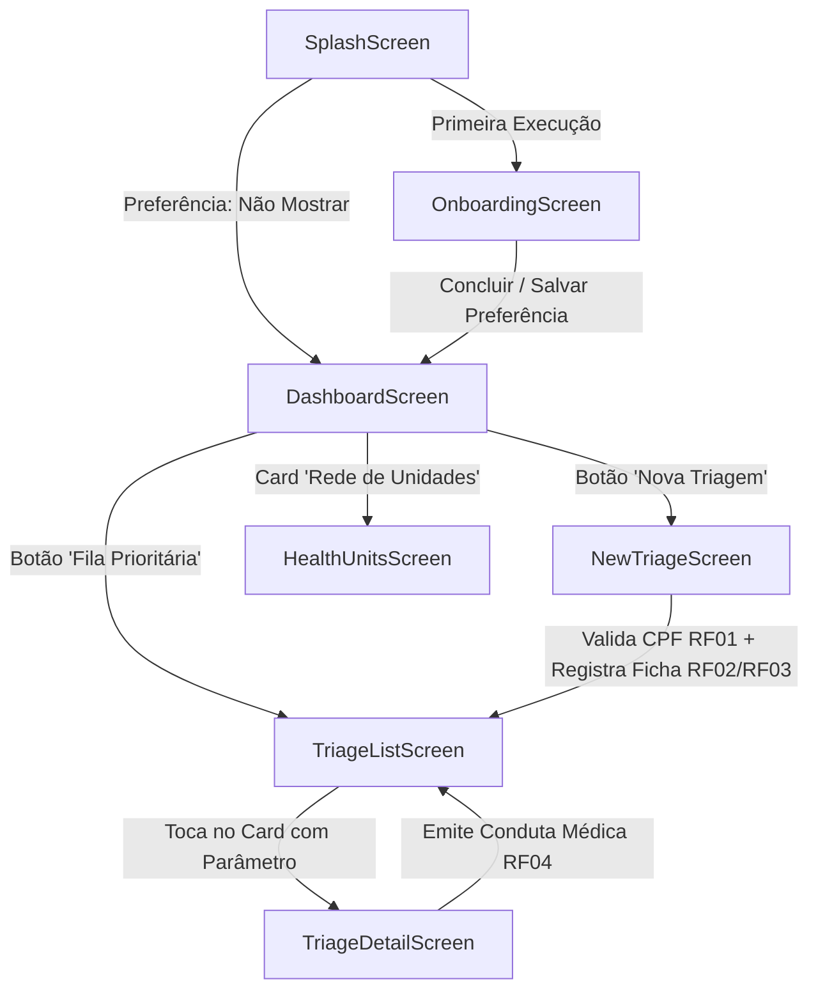

# SaúdePerto — Plataforma de Triagem Preventiva e Orientação Remota para Comunidades Isoladas

> **Global Solution 2026.2 — CitizenTech**  
> **Curso:** Sistemas de Informação (3SI) — 3.º Ano  
> **Instituição:** FIAP  

---


##  Identificação dos Desenvolvedores

| Nome Completo | RM | Responsabilidades Principais |
|---|---|---|
| **Guilherme Buglioli** | **555273** | Arquitetura Flutter, Modelagem de Dados, Motor de Risco Clínico e UI/UX |
| **Lucas Pasqualini** | **555169** | Consumo de WebService REST (HTTP), Persistência Local (SharedPreferences) e Validação de Casos de Uso |

---

## 🎯 Tema da Global Solution & Conexão com os ODS da ONU

### 1. O Problema Real
Moradores de regiões periféricas, comunidades ribeirinhas, aldeias indígenas e zonas rurais enfrentam barreiras geográficas severas e carência de profissionais no território. A ausência de triagem primária faz com que quadros tratáveis (como crises hipertensivas, descompensações glicêmicas ou infecções agudas) se agravem. Ao mesmo tempo, casos simples geram viagens fluviais ou terrestres de horas, sobrecarregando hospitais centrais com demandas que poderiam ser resolvidas localmente.

### 2. O Propósito do SaúdePerto
O **SaúdePerto** é um aplicativo mobile desenvolvido em **Flutter/Dart** no conceito de **CitizenTech**, desenhado para agentes comunitários de saúde e cidadãos. Ele permite registrar fichas padronizadas com validação cadastral, calcular automaticamente a severidade clínica em tempo real (**Baixo, Moderado ou Urgente**), gerar um protocolo único rastreável e manter uma **fila inteligente priorizada** para teleorientação médica imediata.

### 3. Alinhamento com a Agenda 2030 da ONU
* **ODS 3 (Saúde e Bem-Estar):** Prevenção precoce, triagem de doenças crônicas e infecciosas, e redução de mortes evitáveis em territórios remotos.
* **ODS 10 (Redução das Desigualdades):** Democratização do acesso à conduta médica qualificada independentemente da localização física ou do nível socioeconômico.

### 4. Indicadores de Medição de Impacto (Pitch & Métricas)
* **Redução de Deslocamentos Desnecessários:** Percentual de casos classificados como *Baixo Risco* orientados no próprio território, dispensando o custo e tempo de transporte até o hospital regional.
* **SLA Clínico para Casos Críticos:** Redução drástica do tempo decorrido entre o registro da ficha de *Urgência* e o parecer do profissional de saúde.
* **Cobertura Territorial Ativa:** Monitoramento continuado de pacientes crônicos vinculados à base comunitária.

---

##  Requisitos Obrigatórios Atendidos (Rubrica de Avaliação)

### 1. Tela de Splash (1,0 ponto)
* Logo oficial do aplicativo em alta definição via `Image.asset`.
* Transição automática com animação suave de fade e scale.
* Leitura de preferência via `SharedPreferences`: verifica se o usuário optou por "Não mostrar novamente".
* Redireciona dinamicamente para o **Onboarding** (primeira vez) ou direto para o **Dashboard** (se já visualizado).

### 2. Tela de Introdução / Onboarding (1,5 ponto)
* 3 páginas estruturadas explicando o propósito, o motor clínico e a teleorientação:
  1. *Saúde Perto de Quem Mais Precisa* (Contexto comunitário e ODS 3/10).
  2. *Classificação Automática de Risco* (Sinais vitais e criticidade).
  3. *Fila Prioritária e Redução de Viagens* (Teleorientação e conduta remota).
* Imagens ilustrativas (`Image.asset` com fallback resiliente).
* Título, descrição, indicador visual de progresso (page dots).
* Botões **"Voltar"** (ativo a partir da pág. 2) e **"Avançar / Começar"**.
* Checkbox **"Não mostrar novamente ao iniciar"**.
* Persistência da preferência no `SharedPreferences` ao finalizar o fluxo.

### 3. Navegação entre Telas (1,5 ponto)
O aplicativo possui rotas nomeadas e fluxo completo com navegação declarativa e imperativa:
1. **SplashScreen:** Porta de entrada e verificação de estado.
2. **OnboardingScreen:** Apresentação da proposta em 3 etapas com persistência.
3. **DashboardScreen (Tela Principal 1):** Painel de impacto, contadores de risco, indicador de deslocamentos evitados e status de conectividade.
4. **TriageListScreen (Tela Principal 2):** Fila inteligente ordenada por prioridade médica (Urgente > Moderado > Baixo), com busca em tempo real e filtros.
5. **NewTriageScreen (Tela Principal 3):** Cadastro de ficha com busca e validação de CPF (RF01), sinais vitais estruturados (RF02) e cálculo automático de risco com prévia em tempo real (RF03).
6. **TriageDetailScreen (Tela Principal 4):** Passagem de parâmetros do modelo `Triage`, exibição de sinais vitais em cards visuais e formulário de emissão de teleorientação médica (RF04) que altera o status para "Orientação Emitida".
7. **HealthUnitsScreen (Tela de WebService):** Consumo de endpoint REST com tratamento completo dos 4 estados de rede.

### 4. Consumo de WebService REST (2,0 pontos)
* Utilização do pacote oficial **`http`** (`http.get`).
* Consumo do endpoint REST: `https://jsonplaceholder.typicode.com/users` (mapeado para a entidade comunitária de postos e telepostos de atendimento `HealthUnit`).
* Conversão segura de JSON para models Dart (`HealthUnit.fromJson` e `toJson`).
* **Tratamento obrigatório dos 4 estados:**
  * **Estado 1 — Inicial:** Exibição explicativa antes da execução com botão de busca.
  * **Estado 2 — Carregamento:** Indicador de progresso (`CircularProgressIndicator`) com mensagem contextual.
  * **Estado 3 — Sucesso:** Exibição da listagem de unidades com cards, cálculo de distância, quantidade de médicos, horário de funcionamento e imagem (`Image.network`).
  * **Estado 4 — Erro:** Card visual de erro amigável informando a falha de conexão e disponibilizando o botão **"Tentar Novamente"**.
* **Diferencial para a Banca Avaliadora:** Interruptor *(Switch)* no topo da tela para **"Simular Falha de Conexão"**, permitindo aos avaliadores testar o estado de erro e o botão de retry sem precisar desligar a internet da máquina.

### 5. Componentes Flutter e Organização Visual (1,0 ponto)
Todos os widgets solicitados estão implementados com rigor técnico:
* `Column` e `Row`: Estruturação vertical e horizontal em todos os layouts.
* `Card`: Utilizado nas fichas de triagem, métricas do dashboard, sinais vitais e unidades de saúde.
* `ListView` e `GridView`: Listagem dinâmica de triagens com `ListView.builder` e cards de métricas em grid layout.
* `Scaffold` e `AppBar`: Estrutura padrão em todas as telas com ações e títulos temáticos.
* `ElevatedButton`, `TextButton` e `OutlinedButton`: Hierarquia clara de ações primárias e secundárias.
* `Icon` e `IconButton`: Sinalização semântica de gravidade, favoritos, status e navegação.
* `Image.asset` e `Image.network`: Imagens locais de branding/onboarding e imagens remotas das unidades com placeholders e fallbacks.

### 6. Interações com o Usuário (1,0 ponto)
O aplicativo contempla mais de 5 interações funcionais distintas:
1. **Navegação de item da lista para tela de detalhes:** Ao tocar em qualquer card da fila, o objeto `Triage` é repassado via parâmetro para a `TriageDetailScreen`.
2. **Busca e filtro em tempo real:** Campo de texto dinâmico para buscar por nome, CPF ou protocolo, combinado com chips de risco (Urgente, Moderado, Baixo, Pendente, Orientação Emitida).
3. **Favoritar / Desfavoritar fichas:** Botão de estrela em cada card e na tela de detalhes, com alternância de estado instantânea e filtro "Apenas Favoritos".
4. **Cálculo dinâmico do risco no cadastro:** Conforme os sinais vitais e sintomas são alterados na `NewTriageScreen`, o banner de risco é recalculado instantaneamente pelo motor clínico.
5. **Emissão de teleorientação:** O médico/enfermeiro registra a conduta e o status da triagem muda imediatamente de "Pendente de Avaliação" para "Orientação Emitida".
6. **Controle de retry e erro no WebService:** Alternância interativa entre sucesso e erro com recuperação pelo botão "Tentar Novamente".

### 7. Organização do Projeto, Boas Práticas e Gerenciamento de Estado (2,0 pontos)
* Estrutura de pastas limpa baseada em camadas (*Separation of Concerns*):
  * `lib/models/`: Modelos e enums fortemente tipados (`Triage`, `Patient`, `VitalSigns`, `HealthUnit`, `RiskLevel`, `TriageStatus`, `WebServiceState`).
  * `lib/services/`: Regras de negócio desacopladas da UI (`RiskCalculator`, `TriageService`, `StorageService`, `ApiService`).
  * `lib/screens/`: Telas e fluxos de navegação.
  * `lib/widgets/`: Componentes reutilizáveis e desacoplados (`RiskBadge`, `VitalSignCard`, `MetricCard`, `TriageCard`, `StateViews`).
  * `lib/theme/`: Paleta de cores, tipografia e temas Material 3 acessíveis.
* Gerenciamento de estado nativo com `setState`, mantendo o código sem complexidades desnecessárias e com atualização precisa da interface.
* Testes automatizados unitários e de widgets em `test/widget_test.dart` com 100% de sucesso.
* `flutter analyze` com **Zero Issues** (0 erros, 0 avisos, 0 lints pendentes).

---

##  Estrutura de Diretórios do Projeto

```text
gs_flutter_2/
├── assets/
│   └── images/
│       ├── logo_saudeperto.png       # Logo oficial do aplicativo
│       ├── onboarding_1.png          # Ilustração ODS 3 e 10 / Comunidades
│       ├── onboarding_2.png          # Ilustração Classificação de Risco
│       └── onboarding_3.png          # Ilustração Teleorientação
├── lib/
│   ├── main.dart                     # Entrada do app, rotas e inicialização
│   ├── models/
│   │   ├── enums.dart                # RiskLevel, TriageStatus, WebServiceState
│   │   ├── health_unit_model.dart    # Modelo de Unidade Básica (WebService REST)
│   │   ├── patient_model.dart        # Modelo do Paciente / Cidadão Comunitário
│   │   ├── triage_model.dart         # Modelo da Ficha de Triagem e Orientação
│   │   └── vital_signs_model.dart    # Modelo de Sinais Vitais (PA, Glicemia, Temp, etc.)
│   ├── services/
│   │   ├── api_service.dart          # Consumo de API REST com pacote http
│   │   ├── risk_calculator.dart      # Motor de Classificação Automática de Risco
│   │   ├── storage_service.dart      # Persistência via SharedPreferences
│   │   └── triage_service.dart       # Gestão em memória e fila priorizada
│   ├── screens/
│   │   ├── splash_screen.dart        # Tela de Splash com verificação de prefs
│   │   ├── onboarding_screen.dart    # Tela de Introdução com 3 páginas e checkbox
│   │   ├── dashboard_screen.dart     # Painel de Impacto, Métricas e Ações
│   │   ├── triage_list_screen.dart   # Fila de Triagem com busca e filtros
│   │   ├── new_triage_screen.dart    # Ficha de Cadastro com validação de CPF
│   │   ├── triage_detail_screen.dart # Detalhes da Ficha e Emissão de Conduta
│   │   └── health_units_screen.dart  # Consumo WebService e 4 estados
│   ├── widgets/
│   │   ├── metric_card.dart          # Card de indicador estatístico
│   │   ├── risk_badge.dart           # Badge de severidade clínica (Verde/Amarelo/Vermelho)
│   │   ├── state_views.dart          # LoadingView, ErrorView e InitialView
│   │   ├── triage_card.dart          # Card de ficha para listagens
│   │   └── vital_sign_card.dart      # Card visual de sinal vital com alerta
│   └── theme/
│       ├── app_colors.dart           # Cores do app e das ODS
│       └── app_theme.dart            # Configuração do ThemeData Material 3
├── test/
│   └── widget_test.dart              # Testes unitários do motor de risco e smoke tests
├── pubspec.yaml                      # Configuração de dependências e assets
└── README.md                         # Documentação completa e identificação
```

---

##  Fluxo de Navegação entre Telas



---

## ⚙️ Regras do Motor Clínico de Classificação (RF03)

| Nível de Risco | Cor | Critérios de Sinais Vitais | Sintomas de Alarme | Ação / SLA |
|---|---|---|---|---|
| **URGENTE** | **Vermelho** | PA $\ge$ 180/110 mmHg, Glicemia $\ge$ 300 ou < 50 mg/dL, Temp $\ge$ 39.5 ou < 35°C, FC $\ge$ 130 ou < 45 bpm, SpO2 < 92% | Dor no peito, falta de ar aguda, perda de consciência, sinais de AVC | Teleorientação emergencial ou transporte imediato |
| **MODERADO** | **Amarelo** | PA 140-179/90-109 mmHg, Glicemia 200-299 ou 50-69 mg/dL, Temp 37.8-39.4°C, SpO2 92-94% | Cefaleia intensa, tontura forte, febre contínua, vômitos frequentes | Atendimento prioritário no mesmo dia |
| **BAIXO** | **Verde** | Sinais vitais dentro dos parâmetros normais de referência | Sintomas gripais leves, dores musculares sem alarme, rotina | Resolução domiciliar / autocuidado orientado |

---

##  Consumo de WebService REST (Requisito 4)

* **Biblioteca:** `http: ^1.2.0`
* **Endpoint Base:** `https://jsonplaceholder.typicode.com/users`
* **Estados Implementados:**
  1. `WebServiceState.initial`: Exibição explicativa com convite à sincronização.
  2. `WebServiceState.loading`: Indicador de progresso circular animado e mensagem contextual.
  3. `WebServiceState.success`: Mapeamento para objetos `HealthUnit` com cards ricos e imagens.
  4. `WebServiceState.error`: Feedback amigável para falha de rede com botão **"Tentar Novamente"**.
* **Modo de Demonstração:** Inclui switch no cabeçalho para simulação voluntária de erro, facilitando a verificação dos critérios pela banca.

